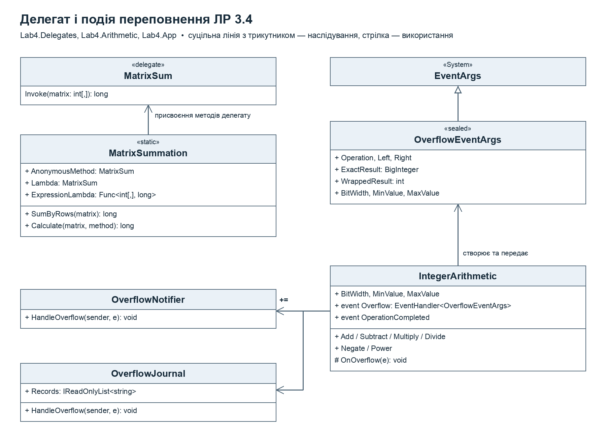

# Лабораторна робота 3.4 — варіант 7

Делегати, події та лямбда-вирази. C# / .NET 8, консольний застосунок для macOS, Windows і Linux. Сторонніх пакетів немає.

## Завдання варіанта 7

| Пункт | Реалізація |
| --- | --- |
| Метод для виклику через делегат | Сума елементів двовимірного цілого масиву: делегат `MatrixSum`, анонімний метод і лямбда-вираз |
| Клас (функціональність) | `IntegerArithmetic` — арифметика з цілими числами: +, −, ×, ділення, зміна знака, степінь |
| Подія | `Overflow` — переповнення розрядної сітки |

## Запуск

~~~bash
dotnet run
~~~

Повна демонстрація без меню:

~~~bash
dotnet run -- --demo
~~~

| Пункт меню | Дія |
| --- | --- |
| 1 / 2 | Сума елементів введеної матриці / матриці-прикладу |
| 3 | Арифметична операція в поточній розрядності |
| 4 | Змінити розрядність (2–32 біти) |
| 5 / 6 | Підписати чи відписати журнал / показати журнал |
| 7 | Повна демонстрація |
| 0 | Вихід |

## Структура

~~~text
ЛР4/
├── Lab4.sln, Lab4.csproj          консольний застосунок
├── Lab4.Delegates/MatrixSum.cs     делегат, анонімний метод, лямбда-вирази
├── Lab4.Arithmetic/                компонент багаторазового використання
│   ├── IntegerArithmetic.cs        клас, у якому генерується подія
│   ├── OverflowEventArgs.cs        клас-аргумент події
│   ├── OperationEventArgs.cs       аргумент події OperationCompleted
│   └── ArithmeticOperation.cs      перелік операцій
├── Lab4.App/
│   ├── OverflowHandlers.cs         класи з методами-обробниками
│   ├── ConsoleMenu.cs, Demonstration.cs, Program.cs
└── Lab4.Tests/Program.cs           17 автоматизованих перевірок
~~~

## Діаграма класів

## Делегат і лямбда-вирази

~~~csharp
public delegate long MatrixSum(int[,] matrix);

public static readonly MatrixSum AnonymousMethod = delegate (int[,] matrix) { ... };
public static readonly MatrixSum Lambda = matrix => { ... };
public static readonly Func<int[,], long> ExpressionLambda = matrix => matrix.Cast<int>().Sum(v => (long)v);
~~~

Результат має тип `long`, бо сума кількох `int` може вийти за межі `int`. Для матриці-прикладу 3×4 сума дорівнює **27**.

## Подія переповнення

`IntegerArithmetic` моделює знакову сітку заданої розрядності. Точний результат обчислюється через `BigInteger`. Якщо він не вміщується в `[MinValue; MaxValue]`, компонент:

1. генерує подію `Overflow` через `protected virtual void OnOverflow(OverflowEventArgs e)`;
2. повертає значення з відкинутими старшими розрядами — так само працює `unchecked` у C#.

Подія оголошена через стандартний `EventHandler<OverflowEventArgs>`. Обробники мають сигнатуру `(object? sender, OverflowEventArgs e)`: `sender` — калькулятор-ініціатор, `e` — операція, операнди, точний і обрізаний результат, межі сітки.

Обробники розташовані в окремих класах `OverflowNotifier` (повідомлення користувачеві) і `OverflowJournal` (журнал). Демонстрація показує мультиадресну підписку `+=`, відписку `-=` та другу подію `OperationCompleted`. Ділення на нуль не є переповненням і повідомляється винятком `DivideByZeroException`.

## Перевірки

~~~bash
dotnet build Lab4.sln
dotnet run --project Lab4.Tests/Lab4.Tests.csproj
~~~
